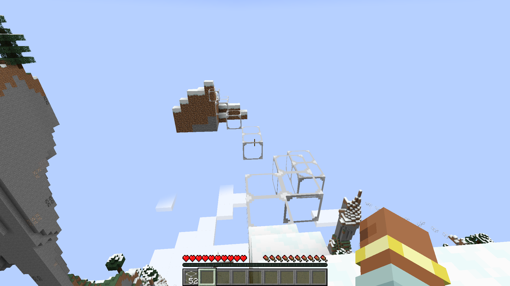

# Angelus

[English](README.md) | 日本語

空中に設置できるブロックを1つ追加します。目線の先に何もない状態で右クリックすると目の前にブロックが現れます。
即座に壊せてインベントリに入ります。

- 設置できる距離は普通のブロックと同じです。
- 水・背の高い草・雪の中にも置けます。
- 枠の中は見通せます。
- 羽根4枚と棒4本で1つ作れます。
- 設定項目はありません。

## スクリーンショット



他の絵は [branding/gallery](branding/gallery) にあります。説明は
[captions.md](branding/gallery/captions.md) です。

## 対象

| Minecraft | ローダー | ほかに必要なもの | Java |
|---|---|---|---|
| 1.21.1 | NeoForge 21.1 | | 21 |
| 1.21.1 | Fabric Loader 0.16 以降 | Fabric API 0.116 以降 | 21 |
| 1.20.1 | Forge 47 以降 | | 17 |
| 1.20.1 | Fabric Loader 0.15 以降 | Fabric API 0.92 以降 | 17 |
| 1.19.2 | Forge 43 以降 | | 17 |
| 1.19.2 | Fabric Loader 0.14 以降 | Fabric API 0.77 以降 | 17 |
| 1.18.2 | Forge 40 以降 | | 17 |
| 1.18.2 | Fabric Loader 0.14 以降 | Fabric API 0.77 以降 | 17 |
| 1.16.5 | Forge 36 以降 | | 8 |
| 1.16.5 | Fabric Loader 0.11 以降 | Fabric API 0.42 以降 | 8 |

組み合わせごとに jar が分かれていて、名前は `angelus-<ローダー>-<Minecraft>-<バージョン>.jar` です。

設置できる距離は普通のブロックと同じで、リーチを変える Mod を入れればこのブロックの距離も変わります。
例外は 1.21.1 より前の Fabric で、リーチにかかわらず本体の決まった距離（4.5 ブロック、クリエイティブでは 5）です。

## ビルド

```
run.bat                         # コンパイルして、選択中のノードの開発クライアントを起動
gradlew build                   # すべてのノードの jar を作る
gradlew runGameTestServer       # ゲームテストのあるすべてのノードでゲームテストを実行
gradlew runData                 # ブロックステート・モデル・レシピ・言語ファイルを作り直す
python tools/make_textures.py   # ブロックのテクスチャを作り直す
python tools/autopilot.py <ノード> --world <ワールド>   # 開発クライアントで確認を自動で行って終了
```

Minecraft のバージョンとローダーの組み合わせごとに、[Stonecutter](https://stonecutter.kikugie.dev/)
のノードが1つあります。ノードの一覧は `settings.gradle.kts` にあり、それぞれ `versions/` の下に
フォルダを持ちます。jar は `versions/<ノード>/build/libs/` にできます。選択中のノードは
`stonecutter.gradle.kts` に書いてあり、`run.bat` が起動するのも、ソースに表示されるのもこのノードです。

autopilot は `src/autopilot` にある開発専用の Mod で、`runAutopilot` タスクだけが読み込み、jar には入りません。
指定したワールドを開いて空中にブロックを置き、1つ壊し、結果を
`versions/<ノード>/autopilot-run/autopilot/result.txt` に PASS/FAIL の行で書き、目で見るしかない部分はスクリーンショットに撮ります。

Minecraft 1.16.5 にはゲームテストの仕組みが無いので、そのノードは autopilot でだけ確かめます。
1.16.5 の Forge の開発クライアントは `versions/1.16.5-forge/devfix/` も読み込みます。Architectury Loom が
名前を変換し損ねる `BlockMath` の2か所の呼び出しを直すコアモッドで、jar には入りません。

`runData` は 1.21.1 の NeoForge のノードでだけ動きます。他のノードは、ビルドのときにその出力を
自分の形式に変換します。

`JAVA_HOME` が JDK 21 を指しているか `java` が `PATH` にある必要があります。古いノードが使う JDK は
Gradle が取ってきます。
テクスチャの生成は `runData` より先に実行してください。

## ライセンス

MIT
