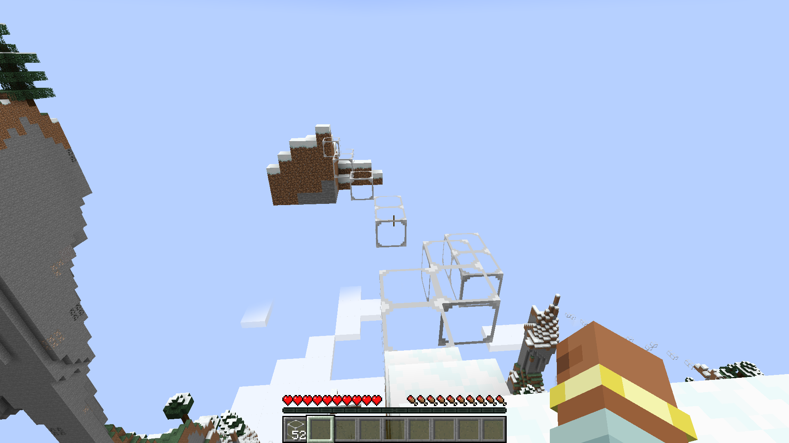

# Angelus

English | [日本語](README.ja.md)

Adds one block that can be placed in mid-air. Right-click with nothing under the
crosshair and the block appears in front of you. It breaks instantly and goes into
your inventory.

- It reaches as far as an ordinary block would.
- It goes into water, tall grass and snow as well as air.
- You can see through the frame.
- Four feathers and four sticks make one.
- There is nothing to configure.

## Screenshots



The rest are in [branding/gallery](branding/gallery), with their captions in
[captions.md](branding/gallery/captions.md).

## Target

| Minecraft | Loader | Also needs | Java |
|---|---|---|---|
| 1.21.1 | NeoForge 21.1 | | 21 |
| 1.21.1 | Fabric Loader 0.16 or later | Fabric API 0.116 or later | 21 |
| 1.20.1 | Forge 47 or later | | 17 |
| 1.20.1 | Fabric Loader 0.15 or later | Fabric API 0.92 or later | 17 |
| 1.19.2 | Forge 43 or later | | 17 |
| 1.19.2 | Fabric Loader 0.14 or later | Fabric API 0.77 or later | 17 |
| 1.18.2 | Forge 40 or later | | 17 |
| 1.18.2 | Fabric Loader 0.14 or later | Fabric API 0.77 or later | 17 |
| 1.16.5 | Forge 36 or later | | 8 |
| 1.16.5 | Fabric Loader 0.11 or later | Fabric API 0.42 or later | 8 |

Each pair has its own jar, named `angelus-<loader>-<minecraft>-<version>.jar`.

The block reaches as far as an ordinary block, and a mod that changes your reach changes it
too. The exception is Fabric before 1.21.1: there it always reaches the vanilla distance, 4.5
blocks or 5 in creative, whatever your reach is.

## Build

```
run.bat                         # compile and launch a dev client for the active node
gradlew build                   # produce a jar for every node
gradlew runGameTestServer       # run every game test on every node that has them, headless, then exit
gradlew runData                 # regenerate blockstate, models, recipe, language, test stage
python tools/make_textures.py   # regenerate the block sprite
python tools/autopilot.py <node> --world <saved world>   # play the checks in a dev client, then exit
```

Each Minecraft version and loader pair is a [Stonecutter](https://stonecutter.kikugie.dev/)
node, listed in `settings.gradle.kts` and given its own folder under `versions/`. A node's jar
is written to `versions/<node>/build/libs/`. The active node, named in `stonecutter.gradle.kts`,
is the one `run.bat` launches and the one the source tree shows.

The autopilot is a dev-only mod in `src/autopilot`, loaded only by the `runAutopilot` task and never part of the jar.
It opens the given world, places blocks in the air, breaks one, records PASS/FAIL lines in
`versions/<node>/autopilot-run/autopilot/result.txt`, and takes screenshots for what only the eye can judge.

Minecraft 1.16.5 has no game test framework, so its nodes are checked by the autopilot only.
The 1.16.5 Forge dev client also loads `versions/1.16.5-forge/devfix/`, a coremod that renames
two calls in `BlockMath` that Architectury Loom leaves unmapped. It is not part of the jar.

`runData` runs on the 1.21.1 NeoForge node only. The other nodes convert its output to their
own format when they build.

`JAVA_HOME` must point at a JDK 21, or `java` must be on `PATH`. Gradle fetches the older JDKs
the other nodes compile against.
Run the texture script before `runData`.

## License

MIT.
